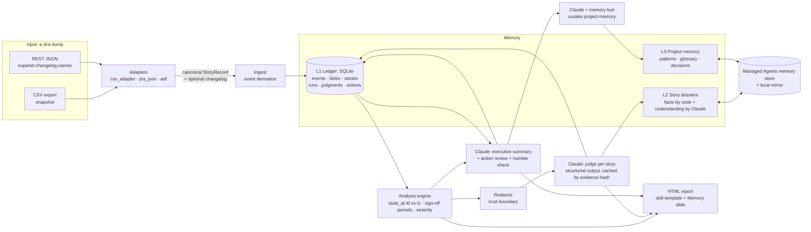

# Scope Change Sentinel accelerator: technical design

Status: v0.1, implemented in `src/scope_sentinel`. 54 automated tests pass. Live Claude API calls are **not yet
verified** (see [§10](#10-what-is-verified-and-what-is-not)).

## 1. What this is, and what changed versus the skill

The original skill answers one question well: *what changed in each user story's Summary, Description and
Acceptance Criteria, did anything move at or after the ToDo sign-off gate, and what does it mean?* It has one
structural limit. A Jira CSV is a snapshot with no change history, so the skill needs two modes and a hand-carried
state file:

| Skill today | Consequence |
|---|---|
| **audit** mode on the first run: infer from comments and timestamps | Findings are "Inferred"; no before/after text |
| **snapshot** mode later: diff against a baseline file you must keep and re-upload | Exact, but only from day 2, and only if the file survives |
| Sign-off "ledger" is a JSON blob inside the snapshot | Lose the file, lose the freeze |
| Every run re-judges every story from scratch | Cost grows; verdicts can wobble between runs |
| Nothing remembers decisions raised in earlier reports | "Did anyone act on last week's actions?" is unanswerable |

The accelerator keeps the skill's analysis rules, severity rubric, flag dictionary and report design, and replaces the
state model with an **event-sourced memory** plus a **Claude-maintained knowledge layer** on top.

## 2. Design principles

1. **Code owns facts, Claude owns interpretation.** Diffs, status transitions, sign-off breaches and counts are
   computed deterministically. Claude explains, rates in context and summarises, and *cannot* override a fact
   (severity floors, protected flags, schema-constrained output).
2. **Append-only history.** Nothing is overwritten. Every event carries *when it happened*, *where we learned it*
   (changelog | observed | record | comment) and *how sure we are* (exact | observed | inferred).
3. **Any window, any time.** Because history is a log, "since 26 Oct", "since last run" and "last Tuesday to Thursday"
   are the same query. No baseline file to keep.
4. **Say how sure you are, per story.** Exact / Observed / Inferred is shown in the report. Never fabricate
   before/after text.
5. **Nothing identifying leaves the machine.** Raw Jira text lives only in a local SQLite file. Everything sent to the
   Claude API or written to a hosted memory store is redacted first.
6. **Degrade, never fail silently.** No API key, a refusal, a budget stop or a bad response falls back to a factual
   deterministic narrative, and the report marks those stories "not yet reviewed".

## 3. Architecture

Module map (all under `src/scope_sentinel/`):

| Module | Role |
|---|---|
| `ingest/csv_adapter.py`, `ingest/jira_json.py`, `ingest/adf.py` | Two sources into one canonical model. Missing columns degrade with a stated warning |
| `memory/store.py` | SQLite event store, content-addressed text blobs, idempotent ingest, runs, judgments, actions, LLM spend ledger |
| `memory/replay.py` | `state_at(story, t)` time travel and sign-off periods (when entered, left, text frozen at that instant) |
| `analysis/engine.py` | Windowed analysis. Three paths: exact/observed, new, inferred |
| `analysis/signals.py` | Ported comment heuristics (first pass only) |
| `redact.py` | Pseudonyms, e-mail/URL/secret scrub, client-term masking, leak gate |
| `memory/backends.py` | `LocalBackend`, `ManagedStoreBackend` (Claude Managed Agents memory store), `MirroredBackend` |
| `memory/dossier.py` | Per-story dossier: machine-written facts + Claude-maintained understanding |
| `llm/client.py`, `schemas.py`, `prompts.py` | Opus 5.5 wrapper: structured outputs, prompt caching, refusal fallback, cost accounting |
| `llm/judge.py`, `executive.py`, `project_memory.py`, `memory_tool.py` | Per-story judgement, portfolio summary and action review, agentic project-memory curation |
| `report/build.py`, `report/template.html` | The skill's report template, extended |
| `pipeline.py`, `cli.py` | Orchestration and the `sentinel` command |
| `demo.py` | Synthetic project (CSV and REST-JSON renderings of the same history) for tests and safe demos |

## 4. Data model and event semantics

### 4.1 Events (system of record)

`events(id, key, ts, type, field, old, new, actor, source, confidence, run_id, payload)`

* Types: `CREATED`, `FIRST_SEEN`, `FIELD_CHANGED`, `STATUS_CHANGED`, `COMMENT_ADDED`, `REMOVED`, `REAPPEARED`.
* `id` is a content hash, so **re-delivering overlapping history adds zero events** (tested).
* Scope text (Summary, Description, AC) is stored in a content-addressed `blobs` table; events hold `blob:<sha>`
  references, so before/after text for any event is retrievable.
* Formatting-only edits (wiki markup, smart quotes, whitespace, account mentions) are recorded but flagged
  `format_only` and never counted as scope change.

### 4.2 Where events come from

| Input | What we learn | Coverage label |
|---|---|---|
| REST JSON **with changelog** | Every field change, with true timestamp and author, back to story creation | `changelog`, events **exact** |
| REST JSON without changelog, or CSV | Differences between this snapshot and the previous one in memory; change time is bounded by the two run times (we use `Updated` when it falls inside) | `observed` |
| Comments (both) | Each comment with its own timestamp | exact |
| Story older than memory, no changelog (first CSV only) | Nothing before the first snapshot | falls to the **inferred** path |

Upgrade path: ingesting a changelog later supersedes earlier snapshot guesses for that story and sets its coverage to
`changelog` (tested). A **truncated** changelog (Jira search returns at most 100 histories per issue) is detected, and
any gap between the replayed value and the current value is recorded as an explicit `reconcile` event instead of being
trusted silently.

### 4.3 Time travel

`state_at(key, t)` starts from the latest projection and reverses every change event after `t`. That one mechanism
serves both sources, because changelog events carry the true old value and observed events carry the previous
snapshot's value. Analysis of a window `(t0, t1]` is then `state_at(t0)` versus `state_at(t1)`.

### 4.4 Sign-off, derived rather than stored

`signoff_periods(key)` walks status events. A period starts when the story enters ToDo-or-later, ends on a move back
below the gate (a regression), and carries the **text as it stood at that instant**. Rules:

* **POST_SIGNOFF_EDIT** (exact when changelog exists): a non-formatting scope edit with `ts` strictly after a period
  start and within it. Severity comes from net drift against the frozen text. An edit later reverted nets to Minor.
* **CHANGED_THEN_SIGNED_OFF**: scope edited at or before sign-off inside the window. Not a breach. From snapshots
  alone the order of edit and sign-off is unknowable; the reason string says so.
* **REGRESSION_FROM_SIGNOFF**, **REWORK_LOOP**, **DESCOPED**, **NEWLY_SIGNED_OFF**: from the status path. With a
  changelog the skill's known blind spot (ToDo → Story Writing → ToDo between runs) disappears.
* **SIGNOFF_PRESSURE** (heuristic): change-request comments made *after* the story entered the gate.

### 4.5 Per-story confidence

`Exact` (changelog covers the window), `Observed` (seen in two snapshots, time-bounded), `Inferred` (story older than
memory: comments and timestamps only, the skill's audit logic). The report's overall mode is "audit" only when
inferred stories outnumber covered ones.

### 4.6 Date-only baselines

`--since 2026-10-26` means "the dump taken that day". It snaps to a run taken on that date so coverage starts exactly
there. (Without this, a 09:00 dump looked "newer" than a midnight baseline and everything fell back to inferred. This
was found while building the demo.)

## 5. Memory layers

| Layer | Content | Written by | Stored in | Rebuildable from SQLite |
|---|---|---|---|---|
| **L1 Ledger** | Events, blobs, projections, runs, judgments, actions, LLM spend | Code | Local SQLite `sentinel.sqlite` | It *is* the source |
| **L2 Story dossier** `/stories/<KEY>.md` | *Facts*: status, coverage, sign-off, scope timeline. *Understanding*: what the story is for, how scope moved, open questions | Facts: code. Understanding: Claude (the judge's `dossier_note`) | Memory backend | Yes: `sentinel memory rebuild` (tested) |
| **L3 Project memory** `/project/*.md` | Patterns, glossary, decisions, overview | Claude via the memory tool, write-restricted to `/project/` | Memory backend | **No.** Restore from the local mirror or the store's version history |
| **L4 Decision tracker** | Actions raised in each report, with status | Code from Claude's structured output; reviewed by Claude next run | SQLite `actions` | It is in the ledger |

Why a dossier is split into FACTS and UNDERSTANDING: the model can read the whole history next run but cannot rewrite
it, so it cannot invent history. If an understanding is wrong, the facts section above it is still authoritative.

### 5.1 The Claude memory backends

`MemoryBackend` has three implementations:

* `LocalBackend`: a directory of markdown files. Offline, tests, and the audit mirror.
* `ManagedStoreBackend`: a **Claude Managed Agents memory store** (`client.beta.memory_stores`). Anthropic-hosted;
  every write becomes an immutable version (audit trail, rollback, `redact` for erasure requests); optimistic
  concurrency via `content_sha256` preconditions; ≤100 KB per document, so one small file per story.
* `MirroredBackend`: the store is the shared source of truth, with write-through to a local mirror for fast reads and
  an offline audit copy. `sentinel memory pull` refreshes the mirror after someone edits documents in the store.

Your answer was "use a Managed Agents memory store or Claude's memory feature; find the best design". The design uses
**both, for different jobs**:

* The **memory store** holds the documents Claude and reviewers read (L2, L3). It is the right fit: small text
  documents, versioned, redactable, attachable to a hosted agent later.
* The **client-side memory tool** (`memory_20250818`) is how Claude *curates* L3. Per-story understanding does not
  need an agent loop (the judge returns it as structured output), so the tool is used once per run, where
  judgement about what to keep is the point.
* **SQLite stays the system of record.** A memory store cannot answer "show every AC edit after sign-off between two
  dates" or guarantee idempotent ingest. Facts need a queryable store; understanding needs a readable one.

## 6. How Claude is used

All calls: `claude-opus-5-5` (your choice), streaming not needed (short structured outputs), `output_config.effort`
set explicitly (Opus 5.5 defaults to `medium`), thinking left at its adaptive default (it cannot be disabled on this
model), prompt caching on the static system prompt, and the server-side refusal fallback on by default.

| Call | Count per run | Input | Output | Notes |
|---|---|---|---|---|
| **Judge** | One per story with a signal (not new-and-quiet, not bulk-noise-only) | Redacted evidence packet: exact diffs, status path, deterministic flags and severity floor, heuristic comment tags, comments with pseudonymised authors, **prior understanding and last judgement from memory** | `Narrative` (structured output): severity, change type, headline, description/AC/status change lines, PM note, flag adds/removes, confidence, dossier note, open questions | **Cached by evidence hash**: unchanged evidence is not re-judged. Floors: severity ≥ the deterministic rubric on exact diffs; protected flags cannot be added or removed |
| **Executive summary** | One | Facts block computed by code, story headlines, previous report's verdict, **open actions with the evidence since they were raised** | `ExecSummary`: verdict, sub-verdict, ≤5 pattern headlines, ≤5 role-owned decisions, **action updates** (resolved / stale / open) | Every figure is checked against the facts; one repair call on mismatch; leftovers are shown in the report ("Check these figures") |
| **Project memory** | One agent loop, ≤10 turns | Run digest | Memory-tool commands | `MemoryToolExecutor` maps `/memories` to the backend; reads everywhere, **writes only under `/memories/project/`** |

Deliberately not used: Managed Agents *sessions* (nothing here needs a hosted sandbox or loop), the Batches API
(daily volume is small; revisit for cumulative backfills), model tiering (you asked for Opus throughout; the model is a
config value if you change your mind).

## 7. Trust boundary and security

* **Redaction** (`redact.py`) before any API call or hosted write: `[~accountid:…]` mentions and bare ids become stable
  pseudonyms (mapping lives only in local SQLite); e-mails, URLs and Jira tenants are masked; configured client terms
  become `[client]`; obvious secrets are masked. Display names are never sent. A `leaks()` gate refuses to write any
  dossier that still contains an id, e-mail or secret. A test asserts that no account id, e-mail, tenant URL, display
  name or configured term appears in any request payload.
* **Prompt injection.** Comments and descriptions are untrusted text written by many people. They sit inside
  `<evidence>` tags, the system prompt states they are data, outputs are schema-constrained, and the model can write
  only under `/project/`. A hostile comment cannot change a story's facts, cannot add a fake breach flag, and cannot
  touch another story's dossier.
* **Memory poisoning.** The residual risk is a persuasive false statement entering an *Understanding* section or the
  project notes. Mitigations: facts and understanding are separated, the store versions every write (roll back), and
  the report labels Claude's text as such. Treat L3 as advice, not evidence.
* **Secrets.** The API key comes from the environment or `ant auth login`; nothing is stored in memory or the repo.
* **Repository hygiene.** `.gitignore` excludes the workspace, SQLite files, dumps, reports and snapshot files. The repo
  holds code and synthetic data only. **Do not commit client Jira data to a personal GitHub account.**
* **HTML output.** Data is embedded as JSON with `<` escaped and rendered through an escaping helper.

## 8. Failure modes

| Situation | Behaviour |
|---|---|
| No API key, SDK missing, or `--no-llm` | Deterministic narratives; report built; stories marked "not yet reviewed". Nothing leaves the machine |
| 401/403/404 from the API on the first batch | Abort with a clear message (never a silent weak report) |
| Refusal on one story | That story falls back; others continue |
| Budget cap reached (`--budget-usd`) | Remaining stories fall back; stated in the run summary |
| Executive summary fails or has untraceable figures | Auto verdict, or the figures are flagged in the report |
| Dump older than the latest run | Rejected unless `--force-order` |
| Same file ingested twice | No-op |
| Filtered export | `--partial` prevents false "removed from scope" |
| Truncated changelog | Detected, warned, reconciled against current values |
| Unknown status names | `doctor` lists them; set `[workflow]` in `sentinel.toml` |
| Memory store edited by someone else | Precondition conflict → re-read and retry once; `memory pull` refreshes the mirror |
| Store lost | `memory rebuild` regenerates dossiers from the ledger |

## 9. Cost model (estimate, not measured)

Rough sizing for a portfolio like your sample (135 stories, ~65 with signals) at Opus 5.5 list prices ($4 / $20 per
million input / output tokens): about 4–6k input and ~0.8k output tokens per judged story, which is ~$0.03–0.05 each.
That puts a first cumulative run at roughly **$2–4** including the summary and the memory call. Rolling daily runs
should cost a fraction of that because unchanged evidence is cached in memory. Treat these as estimates until a real
run reports `spend`: the CLI prints actual spend per run and stores every call in `llm_calls`.

## 10. What is verified, and what is not

**Verified (automated, 54 tests, plus headless-browser checks):**

* CSV and REST-JSON adapters (repeated headers, comment formats, ADF, changelog, truncation, JSONL, missing columns).
* Event semantics: idempotency, ordering guard, time travel, exact sign-off freeze, CSV → changelog upgrade,
  truncated-changelog reconciliation, removal/reappearance, `--partial`.
* Analysis scenarios on a synthetic project: post-sign-off edit, changed-then-signed-off, regression, deferral,
  removal, three-AC add, formatting-only edit ignored, metadata only, bulk-edit noise, duplicate/unfinished titles,
  edit-then-revert. **The CSV path and the JSON path produce identical findings.**
* Redaction and the privacy test; backends, optimistic concurrency, path-traversal rejection; the memory-tool
  executor's write restriction.
* The whole Claude layer against a scripted fake SDK: judge floors, evidence-hash caching, no duplicate decisions on
  re-run, action carry-over and resolution, refusal fallback, credential abort, budget stop, number repair, rebuild.
* The report: renders with no JS errors in a US time zone; your real 135-story sample data also renders in the extended
  template.

**Not verified:**

* **Live Anthropic API calls.** The sandbox had no API key and could not install the SDK. The code follows the
  documented shapes, but these combinations need one real run: `output_config` with both `effort` and a JSON-schema
  `format`; `client.beta.messages.create(..., fallbacks="default")`; re-sending `response.content` blocks in the
  memory-tool loop; `client.beta.memory_stores.*`. If the fallback beta is rejected, set `use_fallbacks = false` in
  `sentinel.toml`.
* **Account constraints.** Structured outputs are unavailable in an organisation using customer-managed encryption
  keys; the judge would then fail per story and fall back to deterministic narratives. A validate-in-code mode is on
  the roadmap (§13) if this applies to you.
* **Your real exports.** The skill zip contained no CSV, so the CSV adapter was built from the skill's own parser and
  the sample report. The REST-JSON adapter follows Jira Cloud's documented schema and was tested only on a synthetic
  rendering. Run `sentinel doctor <file>` on a real dump first.
* **Quality of judgements.** Prompt quality has not been measured against your PM-reviewed verdicts (see roadmap).

## 11. Decisions (ADR summary)

| # | Decision | Why | Alternative rejected |
|---|---|---|---|
| 1 | Event-sourced SQLite as source of truth | Queryable, idempotent, as-of queries, auditable | JSON snapshot files (the skill's way): fragile, no history |
| 2 | One engine for audit and snapshot modes | Mode becomes a per-story confidence, not a separate workflow | Two code paths |
| 3 | Facts by code, interpretation by Claude, floors and protected flags | Prevents invented breaches; makes results reproducible | Let the model decide everything |
| 4 | Dossier = facts section + understanding section | Model reads history but cannot rewrite it | One free-form note per story |
| 5 | Memory tool only for project memory, structured output for story notes | Agent loops only where judgement about *what to keep* matters | Agent loop per story (65× cost and latency) |
| 6 | Managed Agents memory store behind a backend interface, local mirror always | Versioned, redactable, shareable; offline audit; swap-able if the store is unavailable on your platform | Hard dependency on one store |
| 7 | Cache judgements by evidence hash | Cost and stability across runs | Re-judge daily |
| 8 | Redact at the boundary, pseudonymise authors | Client data governance | Send raw text |
| 9 | Extend the skill's HTML template rather than rebuild | Preserves the design reviewed with sponsors; adds a Memory slide and per-story history | New UI |

## 12. Grilling

### 12.1 Questions I put to myself

* **Why not give Claude the full history and let it work it out?** Cost, drift, and no audit trail. Counting edits and
  checking the gate is arithmetic; the model is for meaning.
* **Is the sign-off check right when edits and the status move happen in the same dump?** Only a changelog can say
  which came first. With snapshots the engine reports `CHANGED_THEN_SIGNED_OFF` and says the order is unknown, rather
  than guessing a breach either way.
* **Can Claude launder a false claim into memory through a comment?** It can influence an *Understanding* paragraph.
  It cannot alter facts, flags or other stories, and every write is versioned. Residual risk acknowledged (§7).
* **Does mixing CSV and JSON corrupt history?** Not through values (both normalise to the same text). Timestamps are the
  risk: CSV is in the exporter's zone, JSON carries offsets. Set `tz` in `sentinel.toml` to the zone your CSVs use.
* **Jira's `Updated` changes on every comment. Does that mislead?** Only the observed-event time estimate and bulk-edit
  detection use it, and bulk detection also requires no comments and no scope edits.
* **What if someone deletes a story in Jira?** `REMOVED_FROM_SCOPE`, Major, unless the dump is `--partial`.
* **What if the workflow changes?** Edit `[workflow]` in `sentinel.toml`; unknown statuses are listed by `doctor`.
* **Is SQLite enough?** For one PM or a scheduled job, yes (WAL mode). Multiple concurrent writers need Postgres
  behind the same `Memory` interface.
* **Prompt drift?** `PROMPT_VERSION` is part of the evidence hash, so a prompt change re-judges deliberately.
* **GxP?** This is a project-management aid, not a validated system, but the event log, versioned store and judgement
  records give an audit trail if someone later asks how a verdict was reached.

### 12.2 Questions for you

These change what I build next, in rough order of impact.

1. **Can you pull Jira REST JSON with `expand=changelog,names`?** (API token or an admin.) If yes, day-1 reports are
   exact and the CSV becomes a fallback. If not, exact history starts at your second CSV.
2. **Which model access route is approved for this client: Anthropic API directly, or Bedrock / Vertex / Foundry through
   a cloud tenancy?** Per the platform availability docs, Managed Agents (and so memory stores) are not available on
   those routes, so there you would run with the local backend only. Two more account-level facts to confirm with
   Anthropic: (a) whether your organisation uses **customer-managed encryption keys**: structured outputs, which the
   judge and summary rely on, are not available there, so I would add a validate-in-code mode; (b) data retention terms
   (zero data retention): the docs say nothing specific for Opus 5.5, while some newer models require 30-day retention.
3. **Can you share one sanitised real CSV and, if possible, one real REST JSON?** I could only validate against
   synthetic data and your report. Real headers and comment formats are the biggest remaining unknown.
4. **Where does this run: your laptop, a scheduled job, a shared server?** That decides SQLite vs Postgres, secret
   handling, and whether the Managed memory store is the shared source of truth.
5. **Is the baseline fixed (26 Oct) or rolling?** I default to rolling and support a fixed `--since`. Which does the
   sponsor expect each day?
6. **Is Claude's judgement allowed to reduce severity below the rubric?** Today it cannot go below the deterministic
   floor on exact diffs. Say if the PM wants the final word.
7. **Should decisions write back** to Jira comments or Teams, or stay read-only inside the report?
8. **Do you want chat over the memory** ("what happened to DEMO-3?") via a hosted agent with the store attached?
   The store is already shaped for it.
9. **Retention and erasure:** how long is story history kept, and who may read the store? (`redact` on versions handles
   erasure requests.)
10. **Projects:** one Jira project and filter, or several? Several means one workspace per project, or a project key in
    the memory.

## 13. Roadmap

1. **Eval harness from your PM-reviewed report.** Your sample report holds ~65 stories with human-reviewed severity,
   change type and headline. Kept locally, it is a ready-made gold set to score the judge prompt and tune effort
   (`/claude-api build-eval`).
2. **First live run** on synthetic data with a real key (`sentinel demo --llm`), then on one real dump.
3. **`sentinel ask`**: read-only agent over the store plus ledger queries.
4. **Jira fetch helper** (`/search/jql` pagination, per-issue changelog backfill beyond 100 histories).
5. **Batches API** for large cumulative backfills; model tiering if cost matters.
6. **Postgres backend** and a scheduled run.
7. **Validate-in-code mode** (no structured outputs) for organisations on customer-managed encryption keys.
